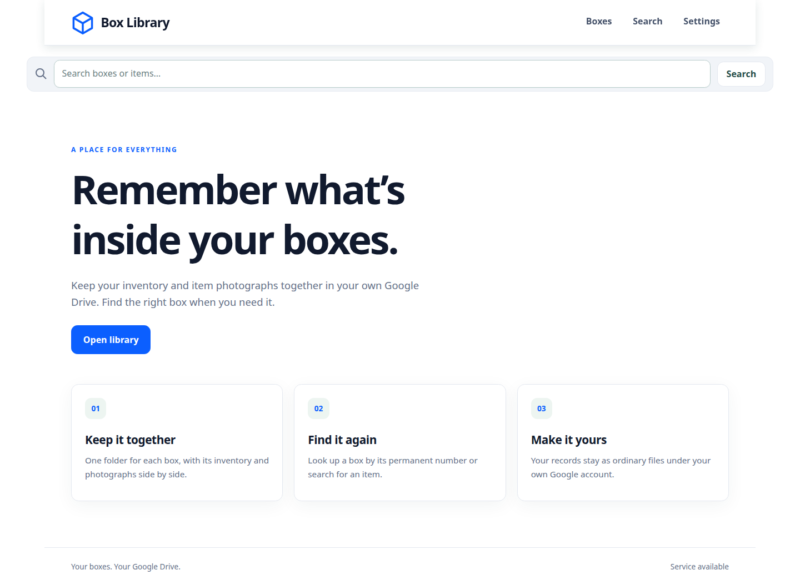
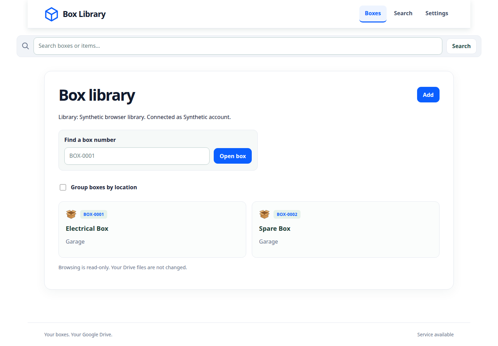
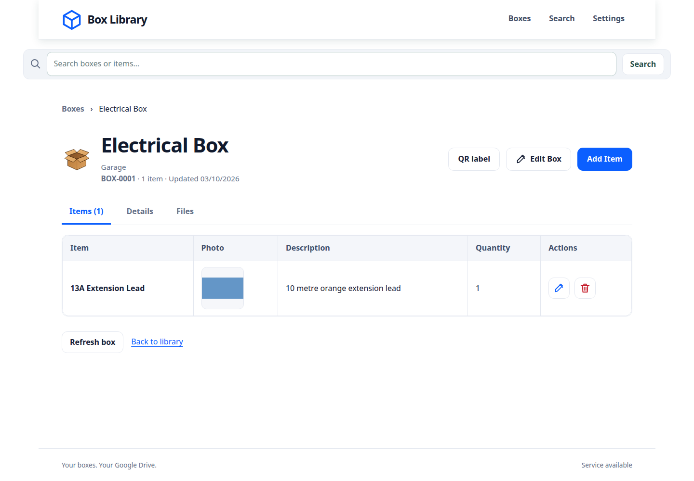
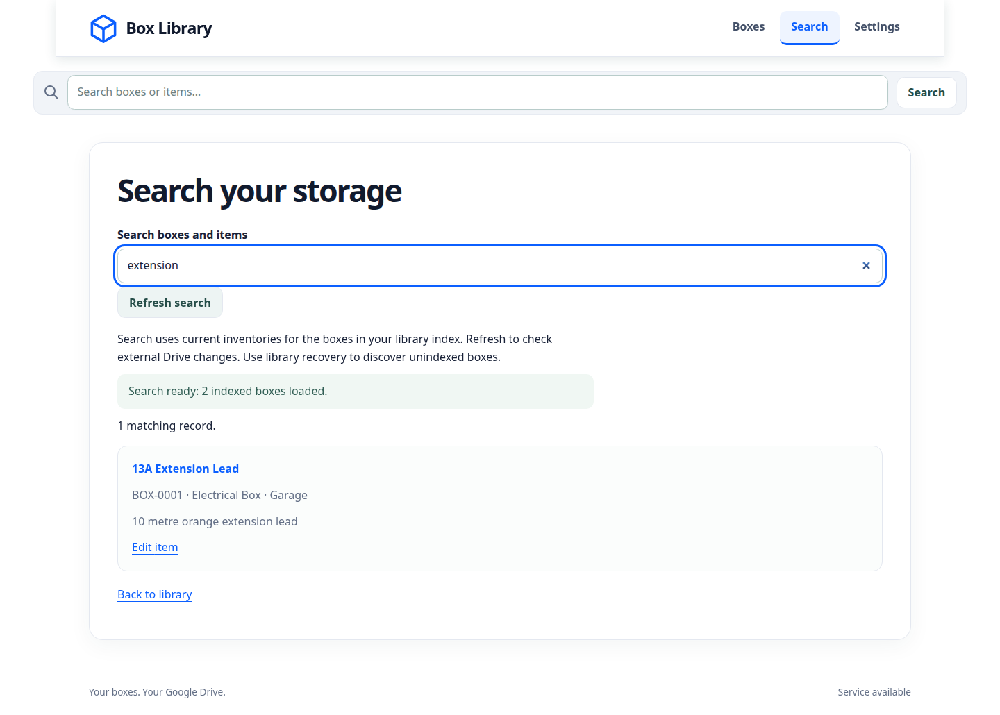
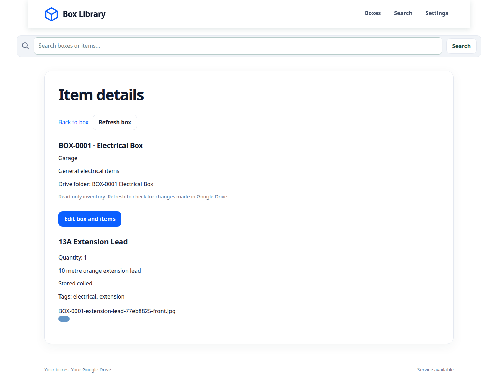
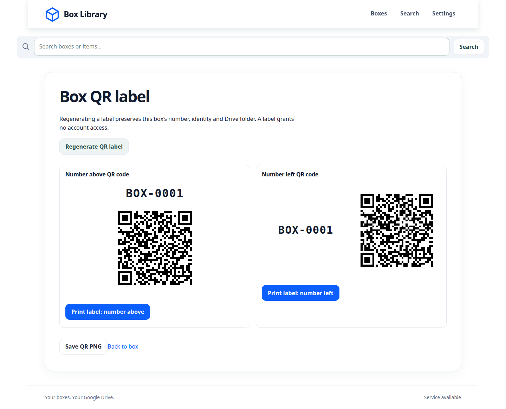
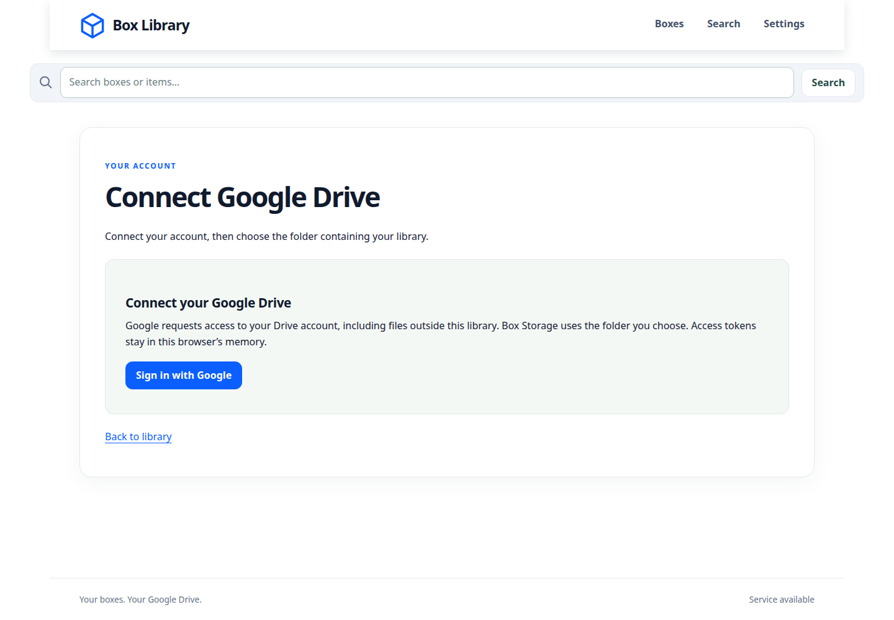
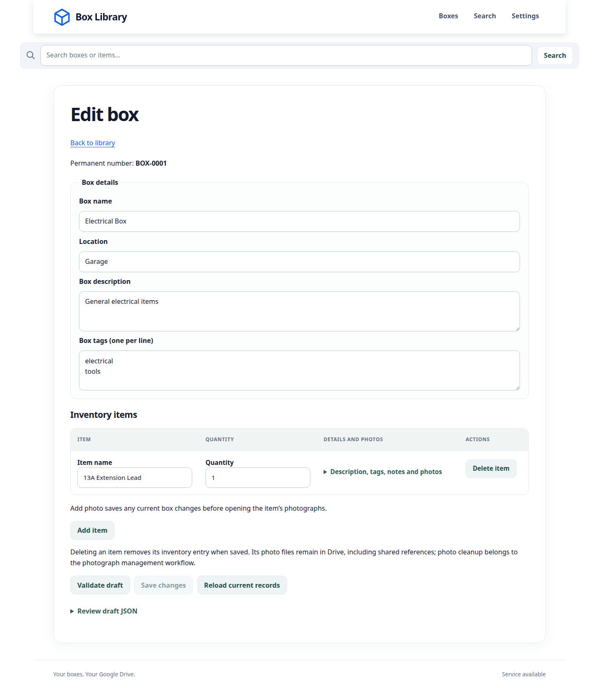
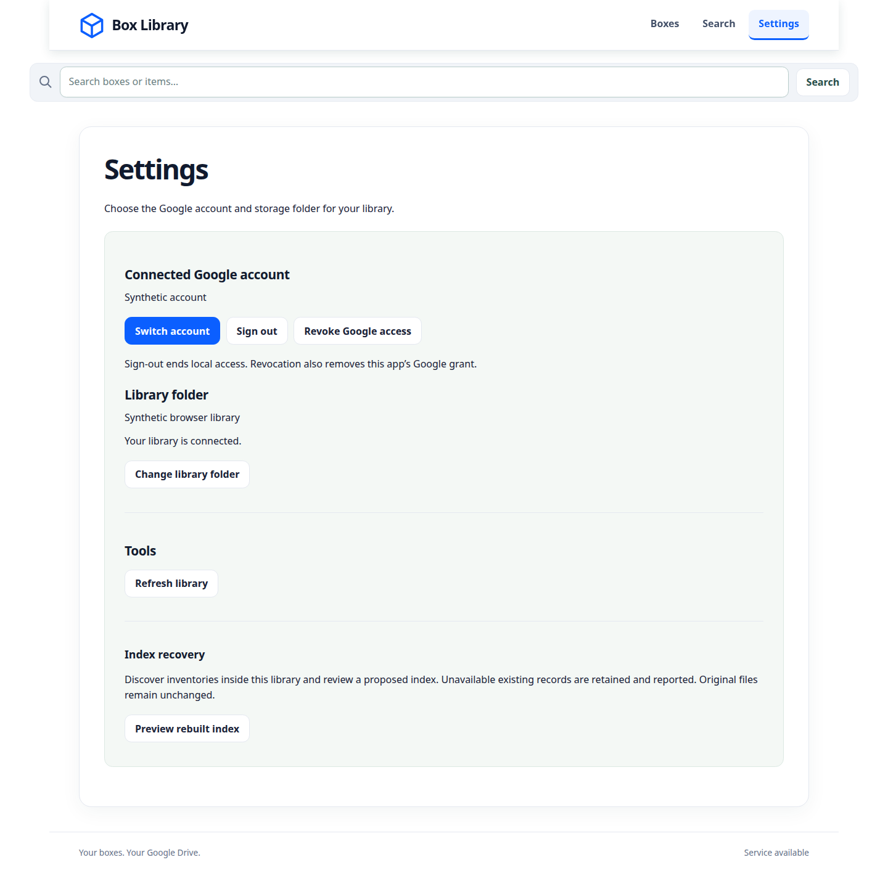

<div align="center">

# BoxStorageMemory

### Remember what’s inside your boxes.

An inventory for the things you put away — with searchable items, photographs and QR labels, stored in your own Google Drive.

[Page tour](#page-tour) · [Get started](#get-started) · [Current status](#current-status) · [Documentation](#documentation)

</div>



## A place for everything

Whether it’s electrical supplies in the garage or spare equipment on a shelf, BoxStorageMemory connects each physical box to a digital inventory. Give it a permanent number, record what’s inside, and find it again by name, location, tag or label.

| Organize                                                                           | Find                                                                | Recognize                                                              | Keep control                                                       |
| ---------------------------------------------------------------------------------- | ------------------------------------------------------------------- | ---------------------------------------------------------------------- | ------------------------------------------------------------------ |
| Group boxes by location and keep item quantities, descriptions and notes together. | Search across indexed boxes and items, or open a box by its number. | View item photographs and print a QR label that links back to the box. | Keep inventories and JPEGs as ordinary files in your Google Drive. |

## Page tour

The images below show the running web app with synthetic demo data and mocked Google responses. They use the repository’s default navigation and box workspace configuration; experimental layouts may differ. No personal account or inventory is shown.

### 01 · Your box library

Browse the library, group boxes by location, look up a box number or start a new box. Each entry leads to its inventory.



### 02 · Everything in one box

Open a box to see its location, description and items. The box workspace brings editing and label actions alongside the inventory, so the physical container and its records stay connected.



### 03 · Find the item, then the box

Search names, descriptions, notes, tags and box numbers across indexed inventories. Results link directly to the matching record and identify its containing box. Search reports incomplete coverage when a box cannot be read.



### 04 · See what you stored

Item pages bring the name, quantity, description, tags, notes and photographs together. Photograph management supports file or camera selection, local JPEG previews and coordinated upload, replacement and removal.



### 05 · Put a link on the box

Generate a printable QR label for a box’s permanent identity. Scanning a label opens that box after the required Google sign-in and library selection. Regenerating a label does not change the box identity.



<details>
<summary><strong>More pages: connect, edit and configure</strong></summary>

### Connect Google Drive

Sign in with Google, then choose the folder containing your library. The operator registers the application once; ordinary users need only their Google account.



### Edit boxes and items

Update box details and item records, validate drafts and save through coordinated writes. Drafts stay in memory; conflicts and interrupted operations require review.



### Account and library settings

Manage the connected account and library folder, refresh records and preview index recovery. Publishing a rebuilt index remains gated.



</details>

## Your files, your Google Drive

The browser talks directly to Google Drive. The FastAPI service provides public configuration, schemas, validation and QR generation; it receives no Google OAuth tokens and maintains no central inventory database.

A library uses ordinary folders and files:

```text
Library folder/
├── box-storage-index.json
└── BOX-0001 Electrical Box/
    ├── inventory.json
    └── BOX-0001-extension-lead-77eb8825-front.jpg
```

Each box has a permanent UUID and a human-readable number. Inventories and photographs live together in the box folder; the library index helps clients find them. Versioned JSON schemas and API contracts support independent clients. Native Android development is a separate project.

## Get started

### Run with Docker Compose

From a checkout with Docker Engine and Compose v2 installed:

```bash
# For a new checkout only; preserve any existing .env.
cp .env.example .env

docker compose up --build --wait
```

Open **http://localhost:8080**.

For Google sign-in, the operator must configure `GOOGLE_WEB_CLIENT_ID` and register the exact trusted browser origin. Follow the [Google application setup guide](docs/google-setup.md#stage-5-application-setup-and-live-checks). Without a client ID, the stateless API remains available and the web app explains that sign-in needs operator setup. Users do not need their own Cloud project or payment-card setup.

Use [the deployment runbook](docs/deployment.md) for public HTTPS hosting, configuration and recovery.

### Develop locally

Requires Python 3.12 and Node 22.13 or newer in the Node 22 series. From the repository root:

```bash
python3 -m venv .venv
.venv/bin/python -m pip install --require-hashes -r requirements-dev.lock
npm ci --ignore-scripts --no-audit --no-fund
npm run build
.venv/bin/python -m backend.app
```

Open **http://localhost:8080**. For Vite live reload, configuration details and the full verification commands, see [development instructions](docs/development.md).

## Current status

This repository is a **1.0.0 release candidate**. Box creation, ordinary box/item saving and photograph management use coordinated Drive v2 writes, with live verification recorded in the linked workflow reports. Full writable production release acceptance remains incomplete.

| Capability                                                          | Status                                                                |
| ------------------------------------------------------------------- | --------------------------------------------------------------------- |
| Google connection, library browsing, item detail and search         | Implemented; search covers indexed inventories.                       |
| Library initialization and box creation                             | Enabled through verified index initialization and coordinated writes. |
| Box/item additions, updates and removals                            | Enabled through coordinated writes with conflict checks.              |
| Photograph upload, replacement, reference removal and owned cleanup | Enabled through the coordinated photo protocol.                       |
| QR generation, printing and browser scanning                        | Implemented; physical camera/device acceptance remains pending.       |
| NFC registration and mutation                                       | Gated; physical tag and cross-reader checks remain pending.           |
| Index recovery                                                      | Preview available; rebuilt-index publication remains gated.           |
| Interrupted-operation recovery                                      | Review controls exist; automatic recovery remains gated.              |
| Native Android app                                                  | Separate project; shared integration contracts are provided here.     |

See [release acceptance and remaining checks](docs/release-acceptance.md), [live box creation](docs/live-box-creation-test.md), [live item saving](docs/live-item-save-test.md) and [live photo management](docs/live-photo-management-test.md) for evidence and limits. Browser simulations do not establish real-account concurrency or physical-device acceptance.

## Documentation

| I want to…                       | Read                                                                                                                                                                                                           |
| -------------------------------- | -------------------------------------------------------------------------------------------------------------------------------------------------------------------------------------------------------------- |
| Set up Google sign-in            | [Google setup](docs/google-setup.md) · [Application registration](docs/decisions/006-application-oauth-registration.md)                                                                                        |
| Browse or recover a library      | [Library guide](docs/library.md)                                                                                                                                                                               |
| Create and edit records          | [Editing and interrupted-operation review](docs/editing.md)                                                                                                                                                    |
| Manage photographs               | [Photo guide](docs/photos.md)                                                                                                                                                                                  |
| Search or use labels             | [Search](docs/search.md) · [QR and NFC](docs/qr-nfc.md)                                                                                                                                                        |
| Run, develop or deploy the app   | [Development](docs/development.md) · [Production deployment](docs/deployment.md)                                                                                                                               |
| Integrate another client         | [Client integration](docs/client-integration.md) · [Stateless API](docs/api.md) · [Shared contracts](docs/contracts.md)                                                                                        |
| Inspect the data formats         | [OpenAPI](api/v1/openapi.json) · [Schema manifest](schemas/v1/manifest.json) · [Sample library](examples/library/box-storage-index.json)                                                                       |
| Understand the design            | [Technical specification](docs/Technical%20Specification.md) · [Architecture decisions](docs/decisions/README.md) · [Development plan](plan.md)                                                                |
| Review readiness and performance | [Release acceptance](docs/release-acceptance.md) · [Release notes](docs/release-notes-1.0.0.md) · [Performance review](docs/performance-review.md)                                                             |
| Explore UI work                  | [UX experiments](docs/ux-experiments.md) · [Box workspace](docs/reference-box-experiment.md) · [Photo recognition](docs/photo-recognition-experiment.md) · [Search context](docs/search-context-experiment.md) |

Historical stage findings remain under [`docs/`](docs/), with the full stage handoff in [Stage 12](docs/stage-12-findings.md). The disposable Google integration prototype can be opened with `python3 tools/serve_stage1.py` at `http://localhost:8765/prototypes/stage1/index.html`; its live concurrency gates are documented in [the integration findings](docs/stage-1-findings.md).
